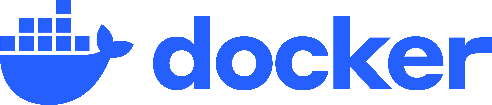

<h1 height="200px" align="center">Hi, I'm Yuzheng Zhang 🌈🐳</h1>

### 🎯 I'm a student researcher interested in Machine Learning Systems and Robot Learning.
### ❤️ Carnegie Mellon University, M.S in Computer Science, Fall 2026 - Spring 2028
### 💜 University of Washington, B.S in Computer Science, Fall 2022 - Spring 2026

  

- 🌱 I'm currently working on **Thor: agent-driven VLA optimization** and **KCoral: Lightweight Benchmark Server for Agentic GPU Programming**.

- 📖 Class highlights at UW: CSE 493G **Deep Learning for Computer Vision**, CSE 447 **Natural Language Processing**, CSE 493L **Concurrency and Rust**, CSE 451 **Operating Systems**.

- 🦜 Fun fact: People also call me Yuzhi - a shortened version of my first name, or Kirin - a friendly name that I like a lot.

- 👨‍💻 All of my projects are available at **[https://github.com/Yuzhifur](https://github.com/Yuzhifur)**.

- 📫 How to reach me: **waynez@andrew.cmu.edu**.

# 📊 Statistics

 

# 🛠️ Languages and Tools:

<!-- Thanks to Logo Author: SAWARATSUKI <3 -->

 

&nbsp;&nbsp;&nbsp;&nbsp;&nbsp;&nbsp;

 

 

 

                

  

